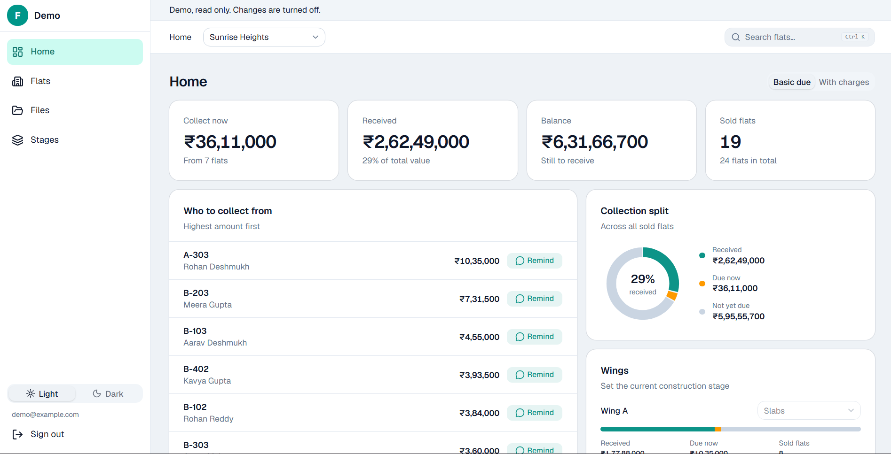
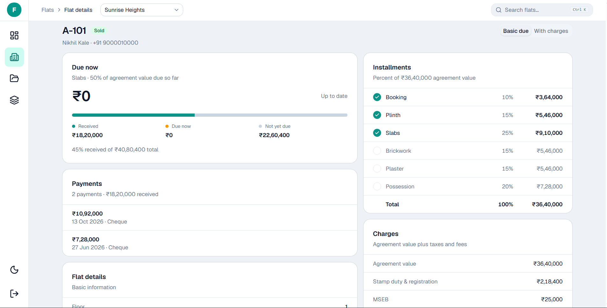
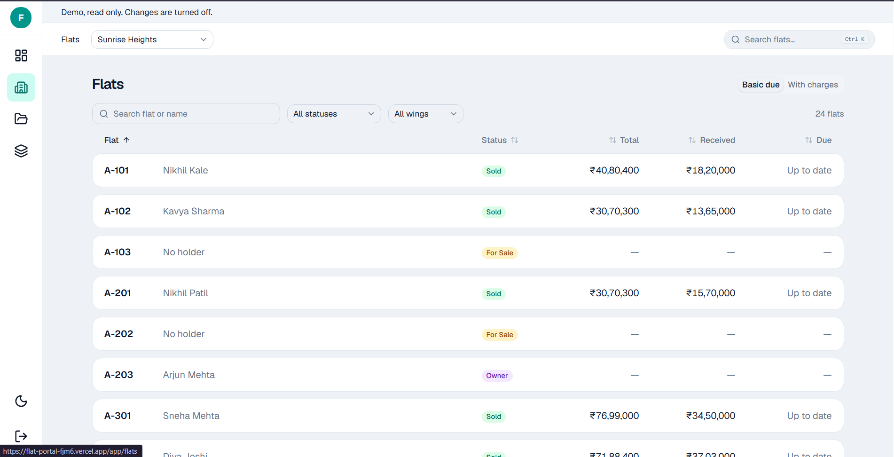

# Flat Portal

**Track every flat, every installment and every payment for your redevelopment project, in one place.**

[**Try the live demo**](https://flat-portal-fjm6.vercel.app) (click **Try demo** on the login page, no sign-up needed)

## The problem

Builders running redevelopment projects track flat-holder payments in Excel sheets
and notebooks. It is hard to see who owes what, which construction stage is due,
and who to call today.

## What Flat Portal does

- **Collection dashboard:** see who to collect from right now, with amounts due.
- **Construction-stage installments:** payments follow your stages (for example
  plinth, slabs, brickwork, possession), with a percentage per flat.
- **Charges and payments:** agreement value, extra charges, every payment received, and the balance.
- **Multi-project and wings:** manage several projects, each with its own wings and flats.
- **Document storage:** keep agreements, site plans and other files in one place.
- **WhatsApp-ready phone numbers:** contact flat holders in one tap.
- **Dark mode.**

## Built for businesses

- Every customer gets a **private workspace**. Their data is isolated by the
  database, not just the app.
- Logins are created and managed by us. There is no public sign-up.
- Accounts can be disabled without losing data.
- Role-based access, with a read-only demo.

See [SECURITY.md](SECURITY.md) for details.

## How to get it

Flat Portal is offered as a **hosted service**. We set up your workspace and
**import your existing data** from Excel or whatever you use today.

Need something specific? **We build features around your needs.**

Email **harshuladwani@gmail.com** to get started.

## Tech stack

Next.js, React, Tailwind CSS, shadcn/ui, Supabase (Postgres, Auth, Storage, Row Level Security).
The database schema is in [schema.sql](schema.sql).

## License

Copyright (c) 2026 Harshul Adwani. All rights reserved. The code is visible for
viewing only. See [LICENSE](LICENSE).
